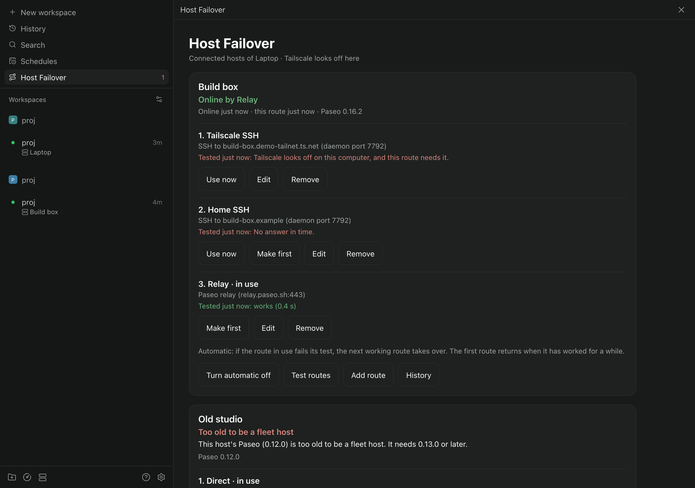

# Host Failover for Paseo

Paseo saves one connection for each connected host. If that connection stops working (Tailscale is off, you left the home network), the host is offline even when another connection would reach it.

Host Failover keeps up to four routes for a host, such as SSH and Paseo's relay. It tests them, switches when the route in use fails, and switches back.



## What it does

- **Failover.** If the route in use fails a full test, the first other route that passes its test takes over. It never switches to a route that has not just passed.
- **Switch back.** The first route returns after it has passed three tests in a row. A route that drops again within half an hour of its return is left alone for longer each time, up to 30 minutes.
- **Reconnect.** If the route passes its test but Paseo has stopped trying, or has not managed for 30 seconds, the plugin connects it again. If that does not help, it uses another route and tries this one later, after 1 to 30 minutes.
- **Plain reasons.** "Tailscale looks off on this computer", "SSH refused the login", "SSH works, but Paseo is not running on that computer", "This route reaches a different computer's Paseo".
- **Version check.** A host that is too old says so, with its version and the version it needs (0.13.0).
- **Desktop and phone**, with a history of every switch.

Automatic switching is **off** until you turn it on for a host.

## Set it up

1. Install it on the computer that has the connected hosts. It needs Paseo 0.16.1 or later there, and 0.13.0 or later on the hosts.
2. Connect the host in Paseo first, if you have not: `paseo host add "ssh://you@host" --label "Build box"`.
3. Open **Host Failover** in the sidebar. Press **Add current route** and enter the connection you gave Paseo. Paseo does not tell plugins what it is.
4. Press **Add route** and enter a second one. For the relay, run `paseo daemon pair` on that host yourself and paste the link.
5. Press **Turn automatic on**.

A route can be `ssh://`, a pairing link, `relay://`, `tcp://`, `ws(s)://` or `host:port`. **Use now** switches by hand and turns automatic off for that host, so your choice stays.

## Your links

A pairing link is a full key to the other computer. Host Failover keeps connections in `~/.paseo-host-failover/<daemon id>/routes.json` (file mode 600, folder mode 700) and nowhere else. A crash during a save can leave a private `.routes-*` copy there until a later save. They are not in the panel, plugin settings, history or logs, and no request returns them. Tests search for a planted link.

- Paseo also stores the connection in use, in its own private `hosts.json`.
- Anyone who may manage plugins on this computer's Paseo can add, remove and switch routes.
- Removing the plugin does not delete the folder. Remove it yourself, or remove the routes in the panel first.
- A saved link must belong to the same Paseo as the host. Every test and every switch checks this again.

## What it never does

It does not add or remove hosts, replace a host's identity, change `~/.ssh/config`, start or stop Tailscale, or run anything on the other computer. A test opens a Paseo connection, reads the version and closes it. While a host is offline its routes are tested with growing pauses (a refused SSH login after 1, 2, 4, then up to 10 minutes). With automatic off, only the route in use is tested. While automatic is on and the host is online, the plugin also opens a TCP connection to the port in use about every 10 seconds, and while a fallback is in use it tests the routes before it about every 15 seconds, less often if they refuse.

If you change a host's connection outside the plugin, Host Failover leaves that host alone until you choose a route.

## Limits

- **After Paseo restarts**, failover starts with the first app connection, agent turn or workspace change. Paseo gives plugins its host list only then.
- **A switch drops open remote views for a few seconds.** Agents on the host keep running. Finish notifications arrive after the switch, but Paseo gives up after three failed tries and then reports "status unknown", so a long outage can lose one.
- **The relay, and SSH through a jump host or `ProxyCommand`,** cannot be probed, so a silent loss is seen only when Paseo sees it (up to about 50 seconds), before testing and switching. The same is true for a direct port that still accepts connections but does not answer.
- **HTTP proxy.** Tests do not use `HTTP_PROXY` settings, so a route that needs one fails its test and is never chosen.
- **Editing the route in use** while its test fails leaves Paseo on the old connection. The panel says so, but forgets after a plugin restart.
- **One daemon per folder.** Two copies of the plugin for the same daemon at once could overwrite each other's edits.
- **Version** is known after a saved route has been tested.
- "Tailscale looks off" means this computer has no Tailscale address. It is a good guess, not an answer from Tailscale.
- Tested on macOS. Linux should work. Windows is untested, and file modes do not apply there.

## Measured

On 2026-11-25, with isolated Paseo 0.16.2 daemons, a local SSH server and Paseo's real relay. The SSH path was made silent, as when a VPN drops.

| Check | Result |
| --- | --- |
| SSH goes silent: online by relay | 18.1 s, 18.7 s |
| SSH login refused: online by relay | 10.1 s |
| Back to SSH after it works again | 44.8 s, and 78.7 s after a repeat drop |
| Agent on the host during the switch | kept running |
| Finish notification, agent done after the switch | arrived |
| Finish notification, agent done while the link was dead | arrived after the switch |
| Real 0.12.0 host | "too old… needs 0.13.0 or later" |
| Relay key in state, plugin output or either daemon's log | not found |

## Development

```sh
npm ci --ignore-scripts
npm run typecheck
npm test
```

MIT. Uses Paseo's own `@getpaseo/client` (Apache-2.0); see `THIRD_PARTY_NOTICES.txt`. Screenshots use fictional hosts.
